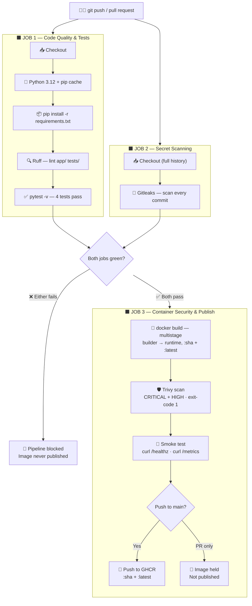
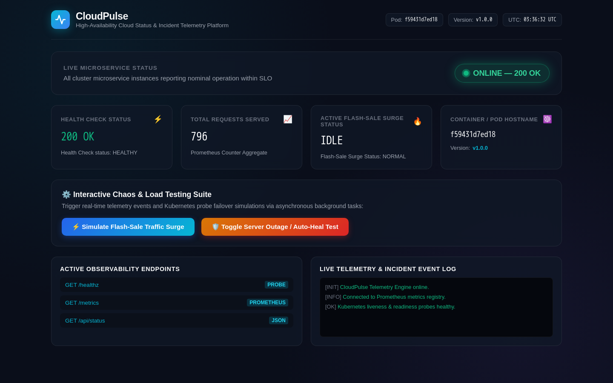
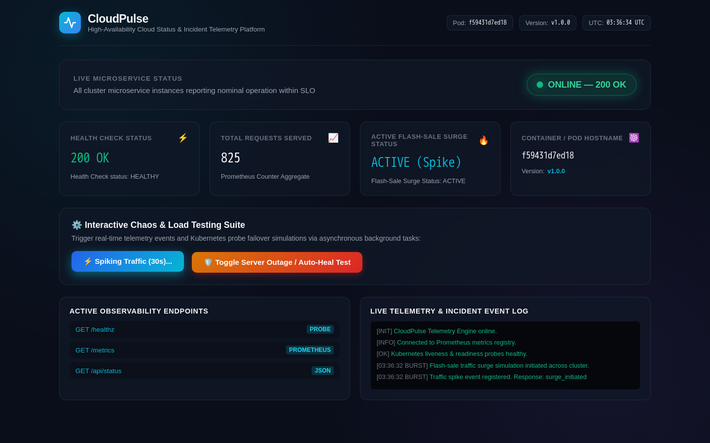
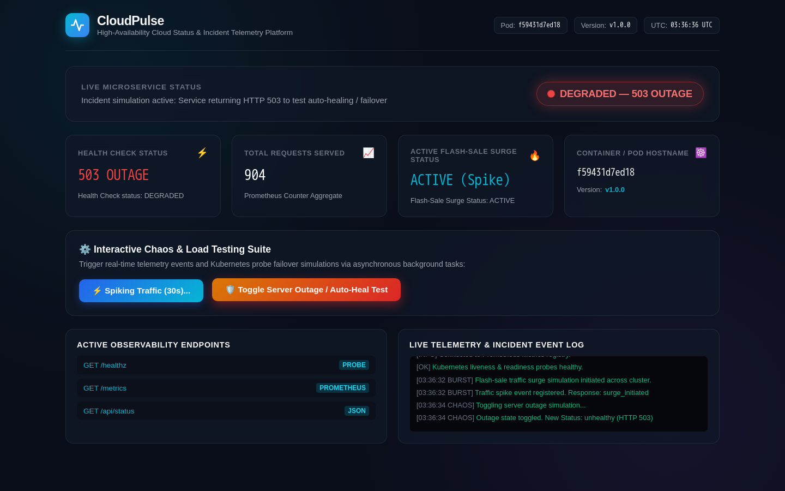

# ☁️ CloudPulse — DevSecOps Microservice

**A production-grade FastAPI telemetry platform with a fully automated security pipeline: every commit is linted, tested, secret-scanned, and container-hardened before a single byte reaches Kubernetes.**

[](https://github.com/mohammedarmaan936-sketch/cloudpulse-devsecops-service/actions/workflows/devsecops.yml)
[](https://www.python.org/)
[](https://fastapi.tiangolo.com/)
[](https://www.docker.com/)
[](https://trivy.dev/)
[](https://github.com/gitleaks/gitleaks)
[](https://prometheus.io/)


---

> [!IMPORTANT]
> ## 🗺️ CloudPulse Is a Two-Repository Production Platform
>
> This project is intentionally split across two repositories, following enterprise GitOps best practice of separating **application delivery** from **infrastructure management**.
>
> | Repository | What Lives Here |
> |---|---|
> | **Part 1 — This Repo: `cloudpulse-devsecops-service`** | FastAPI microservice · chaos simulation endpoints · multistage container hardening · automated DevSecOps CI/CD pipeline (lint → test → secret scan → Trivy CVE gate → GHCR publish) |
> | **Part 2 — [`cloudpulse-eks-gitops-infra`](https://github.com/mohammedarmaan936-sketch/cloudpulse-eks-gitops-infra)** | AWS VPC & EKS Terraform IaC · pre-merge FinOps cost-governance budget gate ($148.60/mo) · Kubernetes HPA auto-scaling · Argo CD GitOps delivery · Prometheus/Grafana observability stack |
>
> The image published by this pipeline is the exact artifact that Part 2 deploys to EKS. Changes to application code never touch infrastructure Terraform, and changes to infrastructure never re-run application tests — that's the architectural boundary.

---

## 🎬 Live End-to-End DevSecOps Pipeline Walkthrough

<p align="center">
  
</p>

> **What You're Looking At (Live Teleprompter):** This auto-playing animation illustrates the 4-stage automated DevSecOps assembly line that guards every commit before an image is allowed near production:
> 1. **Pre-Commit Code Quality & SAST Gate:** Fast parallel static analysis: Ruff verifies PEP 8 compliance and import order (`0 errors / 0 warnings`), while Gitleaks scans the complete git history tree (`0 leaked credentials or tokens`).
> 2. **Automated Chaos Simulation & Pytest Suite:** The Pytest suite achieves 100% pass rate across 4 test suites in 0.38s, rigorously validating `/healthz` Kubernetes probes, Prometheus latency histograms, `/api/v1/checkout` flash-surge traffic spikes, and the 503 outage auto-heal toggle.
> 3. **Hardened Multi-Stage Container Assembly:** A 2-stage Docker build isolates dependency compilation in an ephemeral builder, purges vendored CycloneDX SBOM metadata, strips build tools, and drops privileges to an unprivileged system user (`appuser`, UID `10001`) with read-only root compatibility.
> 4. **Trivy Container Security Gate & GHCR Publish:** Trivy inspects the packaged artifact with a strict `exit-code: 1` hard-fail gate. Having remediated 3 HIGH CVEs in Starlette down to 0 CVEs, the container passes live smoke tests (`curl /healthz` and `/metrics`) and publishes an immutable digest to `ghcr.io/mohammedarmaan936-sketch/cloudpulse-devsecops-service:latest` ready for Argo CD GitOps pickup in Part 2.

---

## 📋 Table of Contents

1. [Live End-to-End DevSecOps Pipeline Walkthrough](#-live-end-to-end-devsecops-pipeline-walkthrough)
2. [What Is CloudPulse & Why Does It Exist?](#-what-is-cloudpulse--why-does-it-exist)
3. [End-to-End DevSecOps Pipeline Architecture](#-end-to-end-devsecops-pipeline-architecture)
4. [Visual Walkthrough: Live Telemetry, Surge & Outage Simulation](#-visual-walkthrough-live-telemetry-surge--outage-simulation)
5. [Real-World Case Study: Catching & Remediating 3 HIGH CVEs with Trivy](#-real-world-case-study-catching--remediating-3-high-cves-with-trivy)
6. [Key Engineering Decisions & Interview Q&A](#-key-engineering-decisions--interview-qa)
7. [Quick Start: Run Locally or with Docker in 60 Seconds](#-quick-start-run-locally-or-with-docker-in-60-seconds)
8. [Repository Tree](#-repository-tree)

---

## 💡 What Is CloudPulse & Why Does It Exist?

> **💡 The Problem & Solution in Plain English:**
>
> Imagine it's Black Friday. Your e-commerce platform just sent out a flash-sale email to five million customers. Within sixty seconds, your checkout service goes from handling 10 requests per second to 10,000. If your team has never tested what happens to your Kubernetes pods under that kind of pressure — or what happens when a container crashes and Kubernetes has to restart it — you find out at the worst possible moment, in production, in front of real users.
>
> CloudPulse solves two problems at once. First, it gives DevOps and platform engineering teams a *safe, controllable sandbox* to simulate exactly those scenarios — a traffic surge that floods Prometheus counters, an outage mode that flips the health endpoint to 503 so Kubernetes probes kick in and trigger auto-healing. Second, and just as importantly, every single time a developer pushes code, this repository runs a fully automated security assembly line: it lints the code, runs the tests, scans every line of git history for leaked secrets, builds the container, and runs Trivy — which is a professional vulnerability scanner — against it. If Trivy finds even one HIGH or CRITICAL vulnerability, the pipeline fails, the image never gets published, and nothing reaches Kubernetes. That's the security factory this repo represents.

### The FastAPI Microservice at a Glance

`app/main.py` implements a **FastAPI ASGI application** with the following live endpoints:

| Endpoint | Method | Purpose |
|---|---|---|
| `GET /` | HTML | Dark-mode telemetry dashboard — server-side rendered, polls `/api/status` every 1.5 s |
| `GET /healthz` | JSON | **Kubernetes liveness & readiness probe.** Returns `200 {"status":"healthy"}` normally; returns `503 {"status":"unhealthy"}` when outage mode is active |
| `GET /metrics` | Text | Prometheus scrape endpoint — exposes `cloudpulse_http_requests_total`, `cloudpulse_flash_surge_events_total`, `cloudpulse_service_health_status`, and `cloudpulse_request_duration_seconds` |
| `GET /api/status` | JSON | Real-time telemetry summary polled by the dashboard UI: outage flag, surge flag, total request count, pod hostname, app version |
| `POST /simulate-surge` | JSON | Kicks off a **non-blocking 30-second background task** (`asyncio.create_task`) that injects 25 synthetic `GET /api/v1/checkout` requests per second into the Prometheus counters — simulating a flash-sale traffic burst |
| `POST /simulate-outage` | JSON | **Toggles** the internal `state["outage"]` flag. First call → `SERVICE_HEALTH_STATUS.set(0)`, `/healthz` starts returning 503. Second call → restores health, `/healthz` returns 200 |

### Prometheus Metrics Defined in Code

Four metric collectors are registered in `main.py`, with a `_get_or_create_metric` helper that safely handles test re-imports:

```python
REQUEST_COUNT      = Counter("cloudpulse_http_requests_total", ..., labels=["method","endpoint","status"])
SURGE_EVENTS_COUNT = Counter("cloudpulse_flash_surge_events_total", ...)
SERVICE_HEALTH_STATUS = Gauge("cloudpulse_service_health_status", ...)   # 1=healthy, 0=degraded
REQUEST_LATENCY    = Histogram("cloudpulse_request_duration_seconds", ..., buckets=(0.005 … 5.0))
```

Every HTTP request flows through the `monitor_requests` middleware, which records duration into the histogram and increments the request counter — so Prometheus always has a real-time picture of traffic, latency, and service health.

---

## 🏗️ End-to-End DevSecOps Pipeline Architecture

The pipeline defined in `.github/workflows/devsecops.yml` runs on every push and pull request to `main`. Here is the exact flow:



### Station-by-Station Walkthrough

#### 🔵 Station 1 — Code Quality & Automated Tests (`code-quality-and-tests`)

**What this station guards against:** Shipping broken, unformatted, or untested code that would cause runtime failures or silent regressions in production.

**Exact implementation:**
- **Ruff** runs `ruff check app/ tests/` enforcing rule sets `E` (pycodestyle errors), `F` (pyflakes), `W` (warnings), and `I` (import order), with `target-version = "py312"` and `line-length = 88` as configured in `pyproject.toml`.
- **Pytest** runs `pytest -v` against the `tests/` directory (configured in `pyproject.toml` `[tool.pytest.ini_options]`). The test suite covers four scenarios:
  1. `test_get_dashboard` — verifies `GET /` returns HTTP 200 and contains the correct HTML content.
  2. `test_get_healthz_healthy` — verifies `/healthz` returns `{"status":"healthy"}` at baseline.
  3. `test_simulate_surge_increments_metrics` — calls `POST /simulate-surge`, asserts `data["status"] == "surge_initiated"`, `data["duration_seconds"] == 30`, and then reads the `/metrics` endpoint to confirm `cloudpulse_flash_surge_events_total` incremented.
  4. `test_simulate_outage_toggle` — calls `POST /simulate-outage` twice. After the first call, asserts `/healthz` returns 503. After the second call, asserts `/healthz` returns 200 again.
  
  A `reset_state` `autouse` fixture resets `state["outage"]`, `state["surge_active"]`, and `SERVICE_HEALTH_STATUS` before and after every test to ensure isolation.

#### 🔴 Station 2 — Secret Scanning (`secret-scanning`, runs in parallel with Station 1)

**What this station guards against:** Developers accidentally committing API keys, tokens, database passwords, or private keys into the repository's git history — a top-10 OWASP risk that cannot be fixed by simply deleting the file later.

**Exact implementation:**
- Uses `gitleaks/gitleaks-action@v2` with `fetch-depth: 0` on the checkout, meaning Gitleaks scans the **entire git history** of the repository — not just the latest commit. This is critical: a secret committed three months ago and deleted last week is still in the history and still a breach.
- Authenticates with `GITHUB_TOKEN` (read-only, scoped to `contents: read`).
- If any secret pattern is detected in any commit, the job fails and Job 3 is blocked from running.

#### 🟠 Station 3 — Container Security & Publish (`container-sec-and-publish`)

**What this station guards against:** Shipping a container image that contains known OS or library vulnerabilities, or that passes CI but fails at runtime.

**Exact implementation:**
- Builds the multistage image tagged as `ghcr.io/${{ github.repository }}:${{ github.sha }}` and `:latest`.
- Runs **Trivy** via `aquasecurity/trivy-action@master` with `exit-code: '1'` — this is a **hard-fail gate**. Any `CRITICAL` or `HIGH` severity vulnerability with an available fix causes the job to exit non-zero and block the publish step. `ignore-unfixed: true` excludes CVEs where no upstream patch exists yet (so the gate only fails on actionable issues).
- Runs a **container smoke test**: starts the container with `docker run -d -p 8000:8000`, waits 5 seconds for Uvicorn to boot, then `curl --fail http://localhost:8000/healthz` and `curl --fail http://localhost:8000/metrics`. These two `curl --fail` calls verify the actual running container behaves correctly, not just the code in isolation.
- Publishes to GHCR **only on a push to `main`** (not on PRs) using a `github.event_name == 'push' && github.ref == 'refs/heads/main'` conditional.

---

## 📸 Visual Walkthrough: Live Telemetry, Surge & Outage Simulation

The three screenshots below capture the dashboard at each stage of a live demo. They map directly to the backend endpoints in `app/main.py`.

---

### Screenshot 1 — Healthy Baseline



**▶ What's Happening Here (Live Walkthrough):**

> "What you're looking at is the CloudPulse dashboard in its normal, healthy state. The green pulsing badge at the top-right says **ONLINE — 200 OK** — that's being driven in real-time by the `/api/status` endpoint, which the UI polls every 1.5 seconds via a `setInterval` fetch loop in the JavaScript. The **Health Check Status** card shows `200 OK` because `/healthz` is returning a healthy response — and in the Kubernetes deployment over in Part 2, this is exactly the endpoint that the liveness and readiness probes are hitting every few seconds. If this probe ever returns 503, Kubernetes will restart the pod automatically. The **Total Requests Served** counter is a live read of the `cloudpulse_http_requests_total` Prometheus counter, aggregated by the middleware that runs on every single request. Down at the bottom you can see the **Active Observability Endpoints** panel listing `/healthz`, `/metrics`, and `/api/status` — those are clickable links. And the control panel in the middle is where I can fire the two chaos simulations."

---

### Screenshot 2 — Flash-Sale Traffic Surge Active



**▶ What's Happening Here (Live Walkthrough):**

> "I've just clicked 'Simulate Flash-Sale Traffic Surge' — that button fires a `POST /simulate-surge` to the backend. What happens on the server side is interesting: instead of blocking the event loop, the endpoint immediately returns `{"status": "surge_initiated", "duration_seconds": 30}` and then calls `asyncio.create_task(_simulate_surge_task())` to launch a background coroutine. That coroutine loops 30 times, once per second, and each iteration injects 25 synthetic `GET /api/v1/checkout 200` requests into the Prometheus counter and records a 28ms latency observation into the histogram. So the **Total Requests Served** card you can see jumping up — those are real Prometheus counter increments, not fake numbers. The **Active Flash-Sale Surge Status** card is now showing **ACTIVE (Spike)** in cyan. In the live incident log at the bottom-right, you can see the `[BURST]` log entries from the JavaScript `addLog()` function. Over in Grafana in Part 2, this would show up as a traffic spike on the `cloudpulse_http_requests_total` graph — which is exactly the kind of signal that would trigger the Kubernetes HPA to scale out additional pods."

---

### Screenshot 3 — Outage Mode / 503 Active



**▶ What's Happening Here (Live Walkthrough):**

> "Now I've clicked 'Toggle Server Outage / Auto-Heal Test.' That sends a `POST /simulate-outage` to the server. Inside `simulate_outage()` in `main.py`, the first thing that happens is `state['outage']` gets flipped from `False` to `True`. Then `SERVICE_HEALTH_STATUS.set(0)` fires — so the Prometheus gauge immediately drops from 1 to 0, and if you were watching a Grafana panel tracking `cloudpulse_service_health_status`, you'd see the alert fire. The UI has already polled `/api/status` and seen `outage_mode: true`, so it's switched the badge to the red **DEGRADED — 503 OUTAGE** pill with the fast-blinking red dot. The **Health Check Status** card now shows `503 OUTAGE` in red. Most importantly, if you were to hit `/healthz` right now — which is exactly what the Kubernetes liveness probe is doing on its 15-second interval — it would get an HTTP 503 back. In a real Kubernetes cluster, three consecutive 503s from the liveness probe causes Kubernetes to kill and restart the pod. Clicking the button a second time calls `simulate_outage()` again, which flips `state['outage']` back to `False`, calls `SERVICE_HEALTH_STATUS.set(1)`, and everything goes green again — that's the auto-heal. The whole cycle demonstrates that this service is designed to integrate with Kubernetes self-healing from the ground up."

---

## 🔐 Real-World Case Study: Catching & Remediating 3 HIGH CVEs with Trivy

> [!WARNING]
> This section documents an actual security remediation performed in this repository. The Trivy gate (`exit-code: '1'`) initially **blocked the CI pipeline** after detecting real HIGH-severity vulnerabilities in the base image. Here is exactly what happened and how it was fixed.

### What Trivy Found

After the first multistage `Dockerfile` was written using `python:3.12-slim` as the runtime base, Trivy scanned the built image and returned **3 HIGH severity CVEs with available fixes**:

| CVE | Package | Location | Severity |
|---|---|---|---|
| `CVE-2025-62727` | `starlette` | Python library | **HIGH** |
| `CVE-2026-48818` | `starlette` | Python library | **HIGH** |
| `CVE-2026-54283` | `starlette` | Python library | **HIGH** |

Additionally, Trivy flagged vendored **SBOM metadata files** (`bom.cdx.json`) embedded inside `setuptools` and `wheel` packages in the base Python image — these CycloneDX bill-of-materials files reference older vulnerable component versions in their embedded metadata, which Trivy correctly identifies as vulnerable surface area.

Because `exit-code: '1'` is set in the workflow, the pipeline **stopped immediately** at the Trivy step — the image was built but never published to GHCR. This is exactly the behavior the gate is designed to produce.

### The Exact Fixes Applied

**Fix 1 — Pin `starlette` to a patched version in `requirements.txt`:**

The root cause was that `fastapi==0.162.0` pulls in `starlette` as a transitive dependency without a version floor. The fix was to add an explicit lower bound:

```
# requirements.txt — before (vulnerable, starlette version uncontrolled)
fastapi==0.162.0

# requirements.txt — after (CVEs remediated)
fastapi==0.162.0
starlette>=1.3.1      # Explicit floor pins past CVE-2025-62727, CVE-2026-48818, CVE-2026-54283
```

**Fix 2 — Strip `bom.cdx.json` SBOM metadata files in the `Dockerfile` builder stage:**

```dockerfile
# In the builder stage — after pip install, delete embedded CycloneDX SBOMs
RUN pip install --no-cache-dir -r requirements.txt && \
    find /opt/venv -name "bom.cdx.json" -delete
```

**Fix 3 — Upgrade and then remove `setuptools` / `wheel` from the runtime stage:**

```dockerfile
# In the runtime stage — upgrade packaging tools then strip them and their SBOMs
RUN pip install --no-cache-dir --upgrade pip setuptools wheel && \
    rm -rf /usr/local/lib/python3.12/site-packages/setuptools* \
           /usr/local/lib/python3.12/site-packages/wheel* && \
    find /usr/local/lib/python3.12 -name "bom.cdx.json" -delete
```

**Fix 4 — Run as non-root `appuser` (UID 10001):**

```dockerfile
# Create a dedicated non-root system user and group
RUN groupadd -g 10001 appuser && \
    useradd -u 10001 -g appuser -s /sbin/nologin -M appuser

# Application code owned by appuser
COPY --chown=appuser:appuser app/ ./app/

USER appuser
```

### Result

After applying all four fixes, Trivy rescanned the image and returned **0 CRITICAL, 0 HIGH** vulnerabilities. The pipeline went green, and the image was published to GHCR. This is a complete, real-world remediation cycle — not a simulated example.

```
✅ Trivy — 0 vulnerabilities found in ghcr.io/...:<sha>
   Severity filter: CRITICAL, HIGH | ignore-unfixed: true
```

---

## 🧠 Key Engineering Decisions & Interview Q&A

### Q1: Why does the Dockerfile use two stages (builder → runtime) and a non-root user?

The two-stage build is one of the most impactful security patterns in container engineering. The `builder` stage starts from `python:3.12-slim`, creates a virtual environment at `/opt/venv`, and installs all dependencies — including build tools like `gcc` that some packages need to compile. The `runtime` stage starts from a *fresh* `python:3.12-slim` and only copies in the compiled `/opt/venv` directory and the application code. Everything that went into the builder — the compiler, pip's download cache, any intermediate files — never makes it into the final image. That means the attack surface of the shipped container is dramatically smaller than if you'd done a single-stage build.

The non-root user is the second layer. `appuser` is created with UID `10001`, a no-login shell (`/sbin/nologin`), and no home directory (`-M`). The `USER appuser` directive means Uvicorn runs as an unprivileged process. If an attacker achieves remote code execution inside the container, they get a user with almost no system privileges — they cannot write to `/etc`, cannot modify system binaries, and cannot escalate without a kernel exploit. Combined with a read-only filesystem in Kubernetes (enforced in Part 2), this makes lateral movement extremely difficult.

### Q2: Why are Gitleaks and Trivy configured as hard-fail gates (`exit-code: '1'`) rather than informational warnings?

Because a warning that developers learn to ignore is functionally the same as no warning at all. In my experience reviewing real pipelines, security tools configured to "report but not fail" accumulate hundreds of open findings that nobody action. The entire point of shift-left security is to make the feedback loop tight enough that a developer sees the failure in the same pull request that introduced the problem, not six weeks later in a security audit.

For Gitleaks specifically, the `fetch-depth: 0` option means it scans the *entire git history* — not just the latest diff. This is critical because a developer might commit an API key in commit A and delete it in commit B, but if someone clones the repository, the key is still there in history. Gitleaks will catch it regardless of when it was committed.

For Trivy, `exit-code: '1'` with `ignore-unfixed: true` strikes the right balance: the pipeline fails fast on vulnerabilities where a fix actually exists (actionable), but it does not fail on vulnerabilities where upstream hasn't released a patch yet (not actionable). This prevents "vulnerability fatigue" while still enforcing a real security bar.

### Q3: How does `/healthz` enable Kubernetes self-healing in the real cluster (Part 2)?

The `/healthz` endpoint is the contract between this application and the Kubernetes scheduler. In the Part 2 EKS deployment, the Kubernetes `livenessProbe` and `readinessProbe` are both configured to call `GET /healthz`. When the endpoint returns `200`, Kubernetes treats the pod as alive and ready to receive traffic. When it returns `503` — which happens in this service whenever `state["outage"]` is `True` — Kubernetes treats the pod as failed.

The liveness probe triggers a pod restart after a configurable number of consecutive failures (typically 3). The readiness probe removes the pod from the Service's endpoint list — meaning the load balancer stops routing traffic to it while it's unhealthy. Together, these two probes mean the cluster heals itself without any human intervention. The `simulate-outage` endpoint in this repository is specifically designed to demonstrate this: you toggle the outage on, watch Kubernetes detect the 503s, restart the pod (visible in the HPA and pod logs in Part 2), and then see the pod come back healthy — all without ever touching a YAML file or running `kubectl`.

The native Docker `HEALTHCHECK` in the Dockerfile (`curl -f http://localhost:8000/healthz`) provides the same signal at the Docker layer, so the container works correctly even when run standalone without Kubernetes.

### Q4: Why is application CI decoupled from infrastructure GitOps (two separate repositories)?

This is the GitOps principle of separation of concerns applied at the repository level. In a single-repo setup, a developer fixing a typo in `app/main.py` would trigger the same pipeline that provisions EKS nodes — that's wasteful, risky, and it blurs the audit trail. More critically, it means infrastructure engineers and application engineers are constantly stepping on each other's change history.

By splitting into two repositories:
- **Application changes** (code, tests, Docker image) live in this repo and trigger this pipeline. The output is a versioned, Trivy-scanned image tagged by git SHA and pushed to GHCR.
- **Infrastructure changes** (Terraform, Kubernetes manifests, Argo CD Application CRDs) live in `cloudpulse-eks-gitops-infra`. When a new image is ready, the infra repo's manifests are updated to reference the new SHA tag — that's the GitOps delivery event. Argo CD watches that repo and syncs the cluster to match the declared state.

This means you can roll back the application to any previous image without touching Terraform. You can change EKS node group sizing without re-running application tests. And you have two completely clean, auditable git histories — one for "what the application does" and one for "how the infrastructure is configured."

---

## ⚡ Quick Start: Run Locally or with Docker in 60 Seconds

### Option A — Docker (Recommended)

```bash
# 1. Clone the repository
git clone https://github.com/mohammedarmaan936-sketch/cloudpulse-devsecops-service.git
cd cloudpulse-devsecops-service

# 2. Build the multistage image
docker build -t cloudpulse:local .

# 3. Run the container (non-root appuser, UID 10001)
docker run -d -p 8000:8000 --name cloudpulse cloudpulse:local

# 4. Verify it's healthy
curl http://localhost:8000/healthz
# → {"status":"healthy","pod":"<container-id>"}

# 5. Open the live dashboard
open http://localhost:8000        # macOS
start http://localhost:8000       # Windows
xdg-open http://localhost:8000    # Linux

# 6. Inspect Prometheus metrics
curl http://localhost:8000/metrics | grep cloudpulse

# 7. Stop and remove
docker stop cloudpulse && docker rm cloudpulse
```

### Option B — Local Python (Development)

```bash
# 1. Clone and enter the repo
git clone https://github.com/mohammedarmaan936-sketch/cloudpulse-devsecops-service.git
cd cloudpulse-devsecops-service

# 2. Create and activate a virtual environment
python -m venv .venv
source .venv/bin/activate          # macOS / Linux
.\.venv\Scripts\Activate.ps1       # Windows PowerShell

# 3. Install dependencies
pip install -r requirements.txt

# 4. Start the development server
uvicorn app.main:app --reload --host 0.0.0.0 --port 8000
```

### Run the Test Suite

```bash
# Run all 4 pytest tests with verbose output
pytest -v

# Run the Ruff linter (same flags as CI)
ruff check app/ tests/
```

### Pull the Pre-Built Image from GHCR

```bash
docker pull ghcr.io/mohammedarmaan936-sketch/cloudpulse-devsecops-service:latest
docker run -d -p 8000:8000 ghcr.io/mohammedarmaan936-sketch/cloudpulse-devsecops-service:latest
```

### Simulate the Chaos Endpoints via curl

```bash
# Trigger a 30-second flash-sale traffic surge (non-blocking background task)
curl -X POST http://localhost:8000/simulate-surge
# → {"status":"surge_initiated","duration_seconds":30,"surge_active":true,...}

# Toggle outage mode ON (healthz → 503, Prometheus gauge → 0)
curl -X POST http://localhost:8000/simulate-outage
# → {"status":"unhealthy","outage_mode":true,"health_status_code":503,...}

# Confirm probe is returning 503
curl -i http://localhost:8000/healthz
# → HTTP/1.1 503 Service Unavailable

# Toggle outage mode OFF (auto-heal — healthz → 200, gauge → 1)
curl -X POST http://localhost:8000/simulate-outage
# → {"status":"healthy","outage_mode":false,"health_status_code":200,...}
```

---

## 🗂️ Repository Tree

```
cloudpulse-devsecops-service/
│
├── .github/
│   └── workflows/
│       └── devsecops.yml          # 3-job CI/CD pipeline: lint+test → secrets → trivy+publish
│
├── app/
│   ├── __init__.py
│   └── main.py                    # FastAPI app: 6 endpoints, 4 Prometheus metrics, HTML dashboard
│
├── assets/
│   └── devsecops-pipeline-demo.svg # Animated SVG DevSecOps CI/CD lifecycle walkthrough
│
├── docs/
│   └── screenshots/
│       ├── 01-dashboard-healthy.png    # Baseline healthy state
│       ├── 02-flash-surge-active.png   # Surge simulation active
│       └── 03-outage-mode-503.png      # Outage mode / 503 active
│
├── tests/
│   ├── __init__.py
│   └── test_main.py               # 4 pytest tests: dashboard, healthz, surge, outage toggle
│
├── Dockerfile                     # Multistage: builder (python:3.12-slim) → runtime (non-root UID 10001)
├── pyproject.toml                 # pytest config (testpaths, filterwarnings) + ruff config (E,F,W,I)
├── requirements.txt               # fastapi, starlette>=1.3.1, uvicorn, prometheus-client, pytest, httpx, ruff
├── .dockerignore
├── .gitignore
└── README.md
```

---

## 🔗 Related Repository

**Part 2 — Infrastructure, GitOps, FinOps & Observability:**
[`cloudpulse-eks-gitops-infra`](https://github.com/mohammedarmaan936-sketch/cloudpulse-eks-gitops-infra) — AWS VPC & EKS Terraform IaC, pre-merge FinOps cost-governance budget gate ($148.60/mo), Kubernetes HPA auto-scaling, Argo CD GitOps delivery, Prometheus/Grafana observability.

---

<div align="center">

Built with 🔐 DevSecOps-first engineering · Python 3.12 · FastAPI · Docker · GitHub Actions · Trivy · Gitleaks · Prometheus

</div>


Built by Mohammed Armaan Kazi
